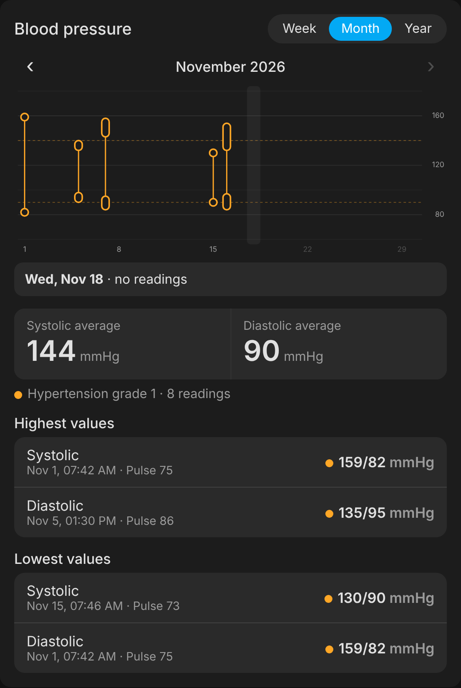
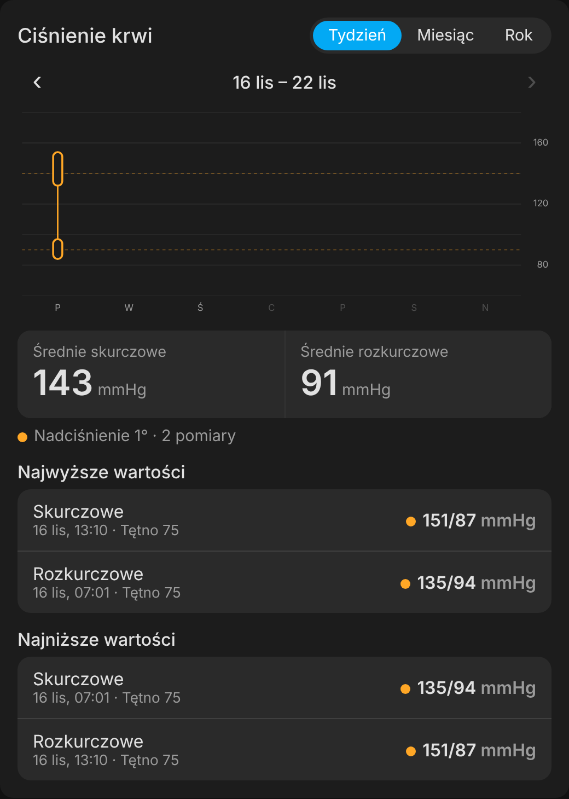

# Blood Pressure Card

A Home Assistant Lovelace card that charts blood pressure the way the Withings app does: one vertical **range candle** per day (or per month in the year view), with a capsule spanning the systolic readings at the top, a capsule spanning the diastolic readings at the bottom and a line joining them. A day with a single reading shows two small circles.

<p>
  
  
  
</p>

- Week / Month / Year views with ‹ › navigation to earlier periods
- Candles coloured by the ESH 2023 category of that day's average
- Tap a day to see its range, average and category
- Period averages, plus the highest and lowest readings with their paired value, date and pulse
- Works with any pair of systolic/diastolic sensors: Withings, the Apple Health sensors from the iOS Companion App, Health Connect, a template sensor…
- Follows the HA theme (light and dark); English and Polish UI
- One plain JS file, no build step and no dependencies

## Install

### HACS (custom repository)

1. HACS → ⋮ → **Custom repositories** → add `https://github.com/uded/blood-pressure-card`, type **Dashboard**.
2. Install **Blood Pressure Card** and reload the browser.

### Manual

Copy `blood-pressure-card.js` to `/config/www/`, then add a dashboard resource:

```yaml
url: /local/blood-pressure-card.js
type: module
```

## Configure

```yaml
type: custom:blood-pressure-card
systolic: sensor.withings_systolic_blood_pressure
diastolic: sensor.withings_diastolic_blood_pressure
pulse: sensor.withings_heart_pulse   # optional, shown next to highest/lowest
```

| Option | Default | Description |
| --- | --- | --- |
| `systolic` | **required** | Systolic sensor (mmHg) |
| `diastolic` | **required** | Diastolic sensor (mmHg) |
| `pulse` | – | Pulse sensor, shown with the highest/lowest readings |
| `title` | localized "Blood pressure" | Card title; `""` hides it |
| `default_view` | `month` | `week`, `month` or `year` |
| `height` | `280` | Chart height in viewBox units (width is 700) |
| `show_stats` | `true` | Show the averages and the highest/lowest lists |
| `pair_window` | `120` | Seconds (1 to 3600) within which systolic and diastolic changes count as one reading |
| `language` | HA language | `en` or `pl` |
| `colors` | ESH palette | Override category colours: `o`, `n`, `hn`, `g1`, `g2`, `g3`. Values are plain CSS colours: `#hex`, `rgb()`, `hsl()`, `var(--name)` or a colour name |

An invalid option (say `pair_window: 2m` or an unknown `default_view`) shows Home Assistant's error card with the reason, instead of a chart with wrong data. `height` must be between 120 and 2000.

For a full-screen panel, put the card in a dashboard view of type **Panel (single card)**.

## How readings are detected

The card reads the recorder **history** (`history/history_during_period`), not long-term statistics, because statistics merge readings into time-weighted averages and carry the last value over days without a reading.

- Each change of the systolic or diastolic state counts as a reading. Changes within `pair_window` seconds of each other are paired into one reading. If only one of the two numbers changed (say 135/87 followed by 128/87), the reading takes the current value of the other.
- A state that just repeats the last numeric value (HA restart, `unavailable` → back) is ignored. The downside is that two identical readings in a row count once. That doesn't change the min/max range but does slightly change the averages.
- Implausible values are dropped as sensor glitches: systolic outside 50 to 300, diastolic outside 20 to 200, or diastolic not below systolic.
- A reading that starts just before a period boundary stays in the period it started in.
- The colour of a day or period comes from its average rounded to whole mmHg, the same number the card shows.

### History retention

The card shows whatever the recorder still has. HA keeps **10 days** by default (`recorder.purge_keep_days`), so out of the box the month view covers the last 10 days. Raise it if you want more:

```yaml
recorder:
  purge_keep_days: 30   # or 90, 365… whatever your database can take
```

When you open a period older than 10 days that has no readings, the card says the history may have been purged.

## Categories (ESH 2023, office BP)

| Key | Category | Systolic | | Diastolic |
| --- | --- | --- | --- | --- |
| `o` | Optimal | < 120 | and | < 80 |
| `n` | Normal | 120–129 | and/or | 80–84 |
| `hn` | High normal | 130–139 | and/or | 85–89 |
| `g1` | Grade 1 hypertension | 140–159 | and/or | 90–99 |
| `g2` | Grade 2 hypertension | 160–179 | and/or | 100–109 |
| `g3` | Grade 3 hypertension | ≥ 180 | and/or | ≥ 110 |

The colours are for orientation only and are not medical advice. Home readings are usually judged against lower thresholds (≥ 135/85).

## Develop

```sh
python3 -m http.server 8765    # then open http://localhost:8765/demo/
node --test test/*.test.mjs
```

The demo page mocks `hass` with 400 days of generated readings. Query parameters: `view=week|month|year`, `theme=light`, `lang=pl`.

## License

MIT · a [Made a Thing Studio](https://github.com/uded/madethingstudio) prowizorka
