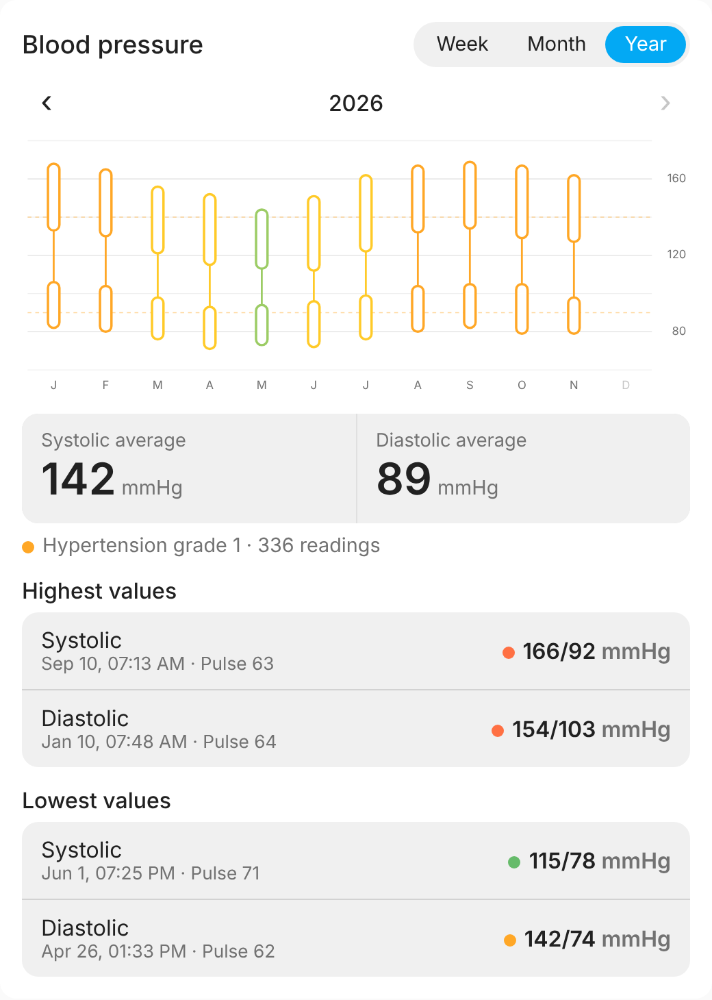

# Blood Pressure Card

A Home Assistant Lovelace card that charts blood pressure the way the Withings app does: one vertical **range candle** per day (or per month in the year view), with a capsule spanning the systolic readings at the top, a capsule spanning the diastolic readings at the bottom and a line joining them. A day with a single reading shows two small circles.

<p>
  
  
  
</p>

- Last 7 / 30 / 365 days (or calendar week / month / year) with ‹ › navigation to earlier periods, back to the oldest history your recorder keeps
- Candles coloured by the ESH 2023 category of that day's average
- Under the chart, the last reading of the period; tap a day to see its range, average and category in the same place, or Tab to the chart and use the arrow keys (Home, End, Escape); screen readers announce the selected day
- Under the chart, the last reading or the period average; tapping a day shows that day in the same place
- The highest and lowest readings with their paired value, date and pulse
- Works with any pair of systolic/diastolic sensors: Withings, the Apple Health sensors from the iOS Companion App, Health Connect, a template sensor…
- Visual editor with entity pickers; `colors` stays YAML-only
- Suggested in the card picker when you pick a systolic or diastolic sensor (newer HA versions), with its partner and pulse sensor filled in
- Follows the HA theme (light and dark); English and Polish UI
- One plain JS file, no build step and no dependencies

## Install

### HACS (custom repository)

1. HACS → ⋮ → **Custom repositories** → add `https://github.com/uded/blood-pressure-card`, type **Dashboard**.
2. Install **Blood Pressure Card** and reload the browser.

### Manual

1. Download `blood-pressure-card.js` from the [latest release](https://github.com/uded/blood-pressure-card/releases/latest) and copy it to `/config/www/`.
2. **Settings → Dashboards → ⋮ → Resources → Add resource**: URL `/local/blood-pressure-card.js?v=1`, type **JavaScript module**. (Resources are only listed with advanced mode on in your user profile.)
3. Reload the browser.

When you update the file, raise the `?v=` number in the resource URL, otherwise browsers and the companion app keep the old version cached. HACS does this for you.

With dashboards in YAML mode, add the same entry to the `resources:` list of your Lovelace configuration:

```yaml
- url: /local/blood-pressure-card.js?v=1
  type: module
```

### Requirements

Home Assistant 2024.1 or newer, with the recorder keeping history for your sensors. Some parts need newer versions and are simply skipped on older ones: sizing in the **Sections** dashboard layout needs 2024.11, and the card suggestion when you pick a sensor needs a recent release (it works in 2026.11).

## Configure

```yaml
type: custom:blood-pressure-card
systolic: sensor.withings_systolic_blood_pressure
diastolic: sensor.withings_diastolic_blood_pressure
pulse: sensor.withings_heart_pulse   # optional, shown next to highest/lowest
```

| Option | Default | Description |
| --- | --- | --- |
| `systolic` | **required** | Systolic sensor (mmHg) |
| `diastolic` | **required** | Diastolic sensor (mmHg) |
| `pulse` | – | Pulse sensor, shown with the highest/lowest readings |
| `title` | localized "Blood pressure" | Card title; `""` hides it |
| `default_view` | `month` | `week`, `month` or `year` |
| `height` | `280` | Chart height in viewBox units (width is 700) |
| `summary` | `last` | What the panel under the chart shows: `last` (the last reading of the period) or `average` (the period average and its category). Tapping a day replaces it with that day |
| `show_extremes` | `true` | Show the highest and lowest readings |
| `range` | `rolling` | `rolling`: the last 7, 30 or 365 days up to today. `calendar`: this week (starting on the first weekday set in your HA profile), this month or this year |
| `thresholds` | `office` | `office` (ESH office table, hypertension from 140/90) or `home` (ESH home threshold, hypertension from 135/85) |
| `pair_window` | `120` | Seconds (1 to 3600) within which systolic and diastolic changes count as one reading |
| `language` | HA language | `en` or `pl` |
| `colors` | ESH palette | Override category colours: `o`, `n`, `hn`, `g1`, `g2`, `g3`. Values are plain CSS colours: `#hex`, `rgb()`, `hsl()`, `var(--name)` or a colour name. The defaults follow the theme: bright shades on dark themes, deeper shades on light ones, each with at least 3:1 contrast against the card |

An invalid option (say `pair_window: 2m` or an unknown `default_view`) shows Home Assistant's error card with the reason, instead of a chart with wrong data. `height` must be between 120 and 2000.

For a full-screen panel, put the card in a dashboard view of type **Panel (single card)**.

## How readings are detected

The card reads the recorder **history** (`history/history_during_period`), not long-term statistics, because statistics merge readings into time-weighted averages and carry the last value over days without a reading.

- Each change of the systolic or diastolic state counts as a reading. Every change within `pair_window` seconds of the first one belongs to the same reading, which takes the values in effect at the end of that window. If only one of the two numbers changed (say 135/87 followed by 128/87), the reading takes the current value of the other.
- The pulse shown with a reading is the one recorded in that same window. A pulse from an earlier measurement is not reused.
- A state that just repeats the last numeric value (HA restart, `unavailable` → back) is ignored. The downside is that two identical readings in a row count once. That doesn't change the min/max range but does slightly change the averages.
- Implausible values are dropped as sensor glitches: systolic outside 50 to 300, diastolic outside 20 to 200, or diastolic not below systolic.
- A reading that starts just before a period boundary stays in the period it started in.
- The colour of a day or period comes from its average rounded to whole mmHg, the same number the card shows.
- If a sensor is `unavailable` at the start of a period, the card looks up to 30 days back for its last value, so the sensor coming back is not counted as a new reading.
- Days follow the time zone setting in your HA profile: your browser's zone by default, or the server's when the profile says so.
- On a dashboard left open, the card moves to the new day, week, month or year just after midnight.

### History retention

The card shows whatever the recorder still has. HA keeps **10 days** by default (`recorder.purge_keep_days`), so out of the box the month view covers the last 10 days. Raise it if you want more:

```yaml
recorder:
  purge_keep_days: 30   # or 90, 365… whatever your database can take
```

When the recorder has no history at all for a period, not even a value from before it, the card says the history may have been purged. A period that is simply empty, with history around it, just shows "No readings in this period".

## Categories (ESH 2023)

With `thresholds: home`, grade 1 hypertension starts at 135/85 instead of 140/90 (the ESH home blood pressure threshold) and the dashed reference lines move with it. ESH defines no home equivalents for grades 2 and 3, so those keep the office values. With `summary: average`, the card shows which table it uses next to the average. Office values:

| Key | Category | Systolic | | Diastolic |
| --- | --- | --- | --- | --- |
| `o` | Optimal | < 120 | and | < 80 |
| `n` | Normal | 120–129 | and/or | 80–84 |
| `hn` | High normal | 130–139 | and/or | 85–89 |
| `g1` | Grade 1 hypertension | 140–159 | and/or | 90–99 |
| `g2` | Grade 2 hypertension | 160–179 | and/or | 100–109 |
| `g3` | Grade 3 hypertension | ≥ 180 | and/or | ≥ 110 |

The colours are for orientation only and are not medical advice. Home readings are usually judged against lower thresholds (≥ 135/85).

## Privacy

Blood pressure is health data. Everyone who can open the dashboard sees the card, and every Home Assistant user can read the sensor history behind it. On a shared or wall-mounted dashboard, put the card in a view that only you can see (**Edit dashboard → view settings → Visible to**), or in a dashboard of its own that is not shown in the sidebar for other users. The card itself sends nothing anywhere: it only reads history from your Home Assistant.

## Develop

```sh
python3 -m http.server 8765    # then open http://localhost:8765/demo/
node --test test/*.test.mjs
```

To release, bump the version in `package.json` and `VERSION` in `blood-pressure-card.js` (the tests check they match), add a `## X.Y.Z` section to `CHANGELOG.md` written for the people installing the card, commit, then push a tag `vX.Y.Z`. The release workflow runs the tests, checks the tag against both versions and publishes a GitHub release with `blood-pressure-card.js` attached, which is what HACS installs, with the changelog section as its notes. An existing release is never overwritten; to fix one, release a new patch version.

The demo page mocks `hass` with 400 days of generated readings. Query parameters: `view=week|month|year`, `theme=light`, `lang=pl`.

## License

MIT · a [Made a Thing Studio](https://github.com/uded/madethingstudio) prowizorka
